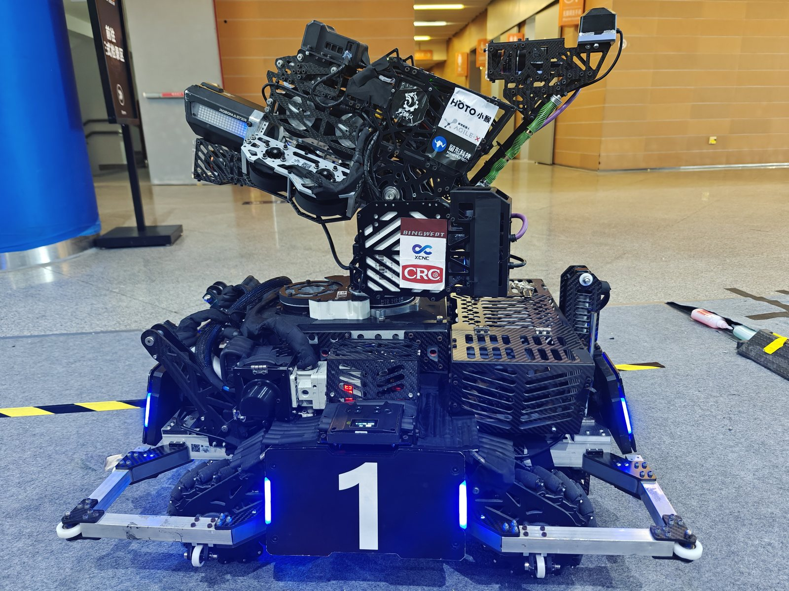
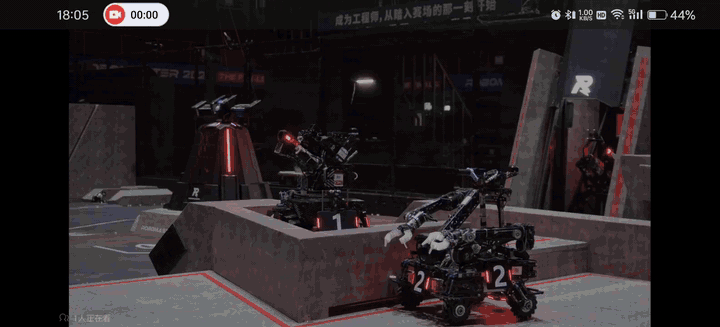
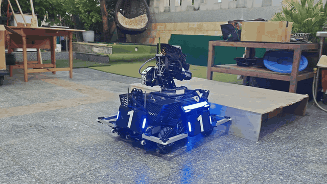
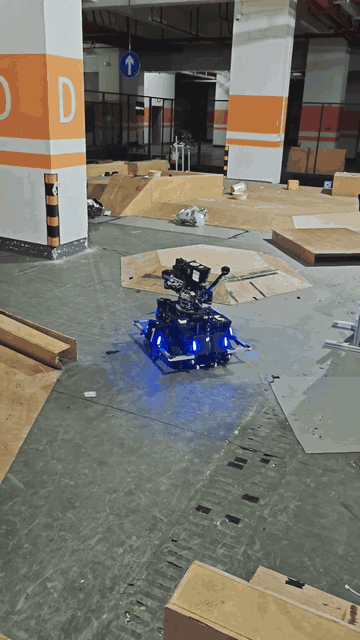
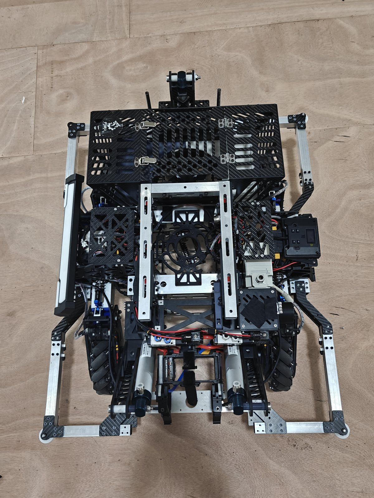
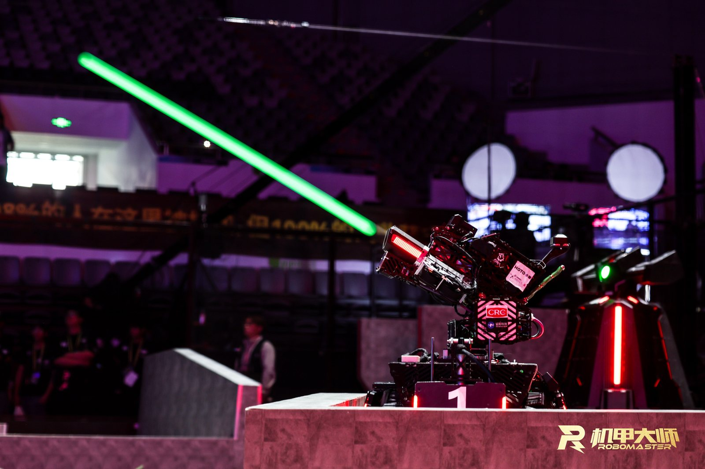

# 26_Hero_Chassis — RoboMaster 英雄机器人底盘板电控

RoboMaster 英雄机器人底盘主控板的嵌入式控制程序，覆盖麦克纳姆轮运动控制、功率管理、超级电容、气动上坎和板间协同。

> **版权说明：** Copyright © 2026 Tummmmmmy. All rights reserved. 本仓库仅用于作品展示与求职评审，未经授权不得复制、修改或再分发。详见 [LICENSE](LICENSE)。

> **项目角色：** 电控负责人，负责整车电控架构、底盘板固件、功率管理、板间协同与实车联调。<br>
> **本仓库范围：** 底盘板固件；云台板固件见 [26_Hero_Gimbal](https://github.com/Tummmmmmy/26_Hero_Gimbal)。

<p align="center">
  
</p>

## 项目亮点

- **整机比赛结果：** RoboMaster 2026 机甲大师超级对抗赛·全国赛 全国一等奖（十二强） | 英雄机器人全国一等奖。
- **整机国赛统计：** 局均命中 6.5 发，局均关键伤害 1759，双项全国第一。
- **底盘控制：** 四轮 M3508 麦轮解算与速度环闭环；双 STM32H723 + FreeRTOS，1 ms 控制周期，FDCAN 接收采用中断入队、任务解析。
- **功率管理：** 功率预测模型 + 裁判系统缓冲能量 PID + 超级电容状态 + 四轮功率分配；专项实车测试中功率利用接近 100%，测试期间无超限扣血。
- **整机协同：** 板间 CAN 指令/状态交换、200 ms 链路超时失能、气动上坎状态机与超级电容充放电管理。

## 项目角色与贡献范围

- 本人负责：整车电控架构、底盘板固件、麦轮运动控制、功率与超级电容管理、CAN 协议、参数整定和实车联调。
- 团队协作：视觉识别算法、机械结构与整车硬件加工。
- 仓库保留赛季迭代记录，当前主线代码位于 `Modules/` 与 `Task/`。

## 第三方组件与原创范围

- 仓库包含 STM32 HAL、CMSIS、FreeRTOS、arm_math 等第三方组件；应用层模块、任务组织、CAN 协议、底盘控制、功率管理、超级电容策略和实车调试为本项目工作。
- 外部参考代码和电机、传感器、裁判系统协议实现按其原许可保留，不作为原创部分展示。

## 实车与演示

### 官方赛事高光

<p align="center">
  <a href="https://www.bilibili.com/video/BV18tuc6LEzY">
    
  </a><br>
  <sub>RoboMaster 官方赛事高光 · 点击观看完整视频（Bilibili）</sub>
</p>

### 技术演示

<table>
  <tr>
    <td align="center"><br>气动上坎与底盘执行</td>
    <td align="center"><br>麦轮底盘运动</td>
  </tr>
</table>

<table>
  <tr>
    <td align="center"><br>底盘与电控布局</td>
    <td align="center"><br>RoboMaster 2026 全国赛现场</td>
  </tr>
</table>

[完整演示视频（1280×720，22.4 s，3.8 MB）](docs/media/chassis-demo.mp4)

---

## 1. 项目概况

### 硬件平台

| 项目 | 规格 |
|---|---|
| MCU | STM32H723VGT6，Cortex-M7，480 MHz |
| RTOS | FreeRTOS / CMSIS-RTOS v2 |
| 底盘电机 | DJI M3508 × 4，CAN 电流控制 |
| 超级电容 | CAN 控制与状态回读 |
| 功率计 | CAN 反馈（调试 / 数据采集用） |
| 上坎机构 | 前 / 后气缸，GPIO 控制 |
| IMU | BMI088，SPI |
| 板间通信 | CAN（与云台板） |
| 裁判系统 | USART1 |
| 状态灯 | WS2812 |

器件型号、CAN 接口和通信链路见 [硬件连接与通信拓扑](docs/hardware-topology.png)。

### 软件环境

- STM32Cube HAL
- FreeRTOS / CMSIS-RTOS v2
- Keil MDK / ARM Compiler 6
- arm_math

---

## 2. 主要功能

### 底盘控制

- 4 个 M3508 麦克纳姆轮解算
- 四轮速度环 PID 闭环
- 逻辑电流到物理电机 ID 的映射
- 底盘使能 / 失能管理

### 功率管理

- 底盘功率预测模型（P = k1·ω·I + k2·I² + k3·ω²）
- 裁判系统缓冲能量 PID 闭环
- 功率预算内的四轮电流差速分配
- 超级电容功率档位与上坎功率策略

### 超级电容

- CAN 充放电指令下发与状态回读
- 基于缓冲能量的充电功率控制
- 放电条件判断与离线保护

### 气动上坎

- 前 / 后气缸状态机
- 基于到位检测的自动伸出逻辑
- 上坎期间自动调整功率预算

### 板间协同

底盘板不直接接收遥控器输入，所有整机指令均来自云台板：

- 接收：底盘速度指令、模式、上坎、超电请求（0x300）与云台姿态 UI 数据（0x308）
- 回传：底盘状态与弹速 / 热量等裁判数据（0x304）
- 拨盘转发：达妙拨盘的速度 / 模式指令与反馈在云台板与拨盘之间透传（0x303→0x207、0x301→0x07、0x17→0x302），拨盘闭环由云台板完成

### 裁判系统

- 裁判系统串口解析、CRC 校验与离线检测
- 底盘 UI 绘制
- WS2812 系统状态灯

---

## 3. 系统结构

整个程序采用基于 FreeRTOS 的任务调度，应用逻辑主要集中在 `Modules/` 中。

```text
                    ┌──────────────────┐
                    │   Gimbal Board   │
                    └────────┬─────────┘
                             │ FDCAN1
                             ▼
┌──────────────┐      ┌──────────────────┐      ┌──────────────┐
│  SuperCap    │◀────▶│  Robot_Control   │◀────▶│ Power Meter  │
│ 0x600 / 0x601│      │   1 ms Control   │      │    0x301     │
└──────────────┘      └────────┬─────────┘      └──────────────┘
                               │
        ┌──────────────────────┼──────────────────────┐
        ▼                      ▼                      ▼
┌────────────────┐     ┌────────────────┐     ┌────────────────┐
│ Chassis Control│     │ Climb Control  │     │ Power Control  │
└────────┬───────┘     └────────┬───────┘     └────────┬───────┘
         │                      │                      │
         └──────────────────────┼──────────────────────┘
                                │
                                ▼
                         ┌──────┴───────┐
                         │   FDCAN2     │
                         └──────┬───────┘
                                │
                                ▼
                      M3508 × 4 / SuperCap
```

更完整的软件分层、任务模型和模块职责见 [架构说明](docs/architecture.md)。

---

## 4. 核心控制链路

系统的主控制循环以约 **1 ms** 为周期运行（`Task/control_task.c` → `Modules/robot_control.c`），每个周期依次完成：

1. 与云台板交换状态，检查失能条件
2. 上坎状态机与 LED 状态更新
3. 底盘解算与四轮速度环
4. 功率控制分配
5. 统一打包发送 0x200 电流指令

```text
云台指令 0x300 ─┐
                │
底盘反馈 0x201~ ├──▶ Robot_Control_Loop()  (1 ms)
                │          │
超电状态 0x600 ─┘          ▼
                    失能检查 / 使能切换
                           │
               ┌───────────┼───────────┐
               ▼           ▼           ▼
          上坎状态机    底盘解算     功率分配
                     （麦轮+速度环）
               │           │           │
               └───────────┼───────────┘
                           ▼
                     0x200 电流指令
                           │
                           ▼
                        M3508 × 4
```

CAN 接收方向则由中断将收到的帧放入消息队列，再由任务完成解析和分发：

```text
FDCAN RX
   ↓
HAL Callback
   ↓
Message Queue
   ↓
Can_Decode_Task
   ↓
CAN_Rx_Route
   ↓
各模块更新电机反馈 / 云台指令 / 超电 / 功率计
```

---

## 5. CAN 分配

| 总线 | 方向 | ID / 说明 |
|---|---|---|
| FDCAN1 | 收 | 0x300 云台整机指令、0x308 UI 数据、0x303 拨盘速度、0x301 拨盘模式 |
| FDCAN1 | 发 | 0x304 底盘状态（弹速 / 热量 / 冷却 / 颜色 / 裁判在线）、0x302 拨盘反馈 |
| FDCAN2 | 发 | 0x200 底盘电机电流、0x601 超级电容指令 |
| FDCAN2 | 收 | 0x201~0x204 底盘电机反馈、0x301 功率计、0x600 超级电容反馈 |
| FDCAN3 | 发 | 0x207 拨盘速度、0x07 拨盘模式 |
| FDCAN3 | 收 | 0x17 达妙拨盘反馈 |

> 注意：`0x301` 在不同总线上含义不同 —— **FDCAN1 = 拨盘模式指令**，**FDCAN2 = 功率计反馈**，改动前先确认总线。

---

## 6. 主要模块

```text
Core/
    STM32 HAL 初始化、main.c、FreeRTOS 配置

Algorithm/
    PID、Ramp、IIR、Kalman、Mahony、EKF、LADRC 等算法

BSP/
    FDCAN、功率计、超级电容、裁判系统串口、调试协议、蜂鸣器

Devices/
    BMI088、Motor、WS2812 等设备驱动

Task/
    control_task、can_task、supercap_task、monitor_task、
    UI_task、INS_task、device_task、print_task

Modules/
    robot_control
    chassis_control
    climb_control
    power_control
    supercap_control
    gimbal_link
    can_receive
    can_transmit
    RM_JudgeSystem

Drivers/
Middlewares/
    STM32 HAL、CMSIS、FreeRTOS 等第三方/底层组件
```

---

## 7. 底盘控制

底盘控制位于 `Modules/chassis_control.c`，输入为云台板下发的 `vx / vy / wz` 速度指令。

```text
vx / vy / wz
     │
     ▼
 麦轮运动学解算
     │
     ▼
 四轮速度环 PID
     │
     ▼
 目标电流（功率控制前）
     ▲
     │
 0x201~0x204 反馈
```

- 麦轮解算将整车速度分解为四个轮子的目标转速
- 每轮使用速度环 PID 闭环，反馈来自 0x201~0x204 电机反馈帧
- 四轮目标电流先经过功率控制，再统一打包为 0x200 电流帧发送
- 逻辑电流与物理电机 ID 的映射在模块内部完成，上层不需要关心接线顺序

---

## 8. 功率与电容管理

底盘功率控制负责在裁判系统功率限制内尽可能保留底盘动力。

```text
目标电流
    │
    ▼
功率模型预测
P = k1·ω·I + k2·I² + k3·ω²
    │
    ▼
缓冲能量 PID（裁判系统）
    │
    ▼
功率预算 ──▶ 差速分配 ──▶ 最终电流（0x200）
```

超级电容由独立任务每 50 ms 决策一次充放电：

- 缓冲能量较高时自动充电，充电功率随缓冲能量升高而增加
- 需要爆发动力（超电请求 / 上坎）时按电量档位提供额外功率
- 超电离线或底盘失能时自动禁止充放电

---

## 9. 安全机制

- 上电默认失能，等待云台板下发使能指令后才进入控制
- 云台板链路超过 200 ms 无数据：立即失能、发送零电流，并收回全部气缸
- 裁判系统切断底盘输出：同样进入失能并发送零电流
- 超级电容离线 2 s 判为离线，电流上限自动回落到保守值
- 底盘电机、板间链路、功率计均有反馈超时离线判定

实际运行时以上保护均由控制循环和巡检任务自动完成，恢复条件满足后自动回到正常控制。

---

## 10. 工程状态

该工程来自 RoboMaster 赛季实际使用的英雄机器人底盘板固件，已经完成实车调试，并在比赛中得到实际验证。

仓库按赛季保留迭代记录，当前主线代码位于 `Modules/` 与 `Task/`。

该仓库主要用于展示机器人嵌入式控制、CAN 通信、实时任务、功率管理以及实车调试相关经验。
